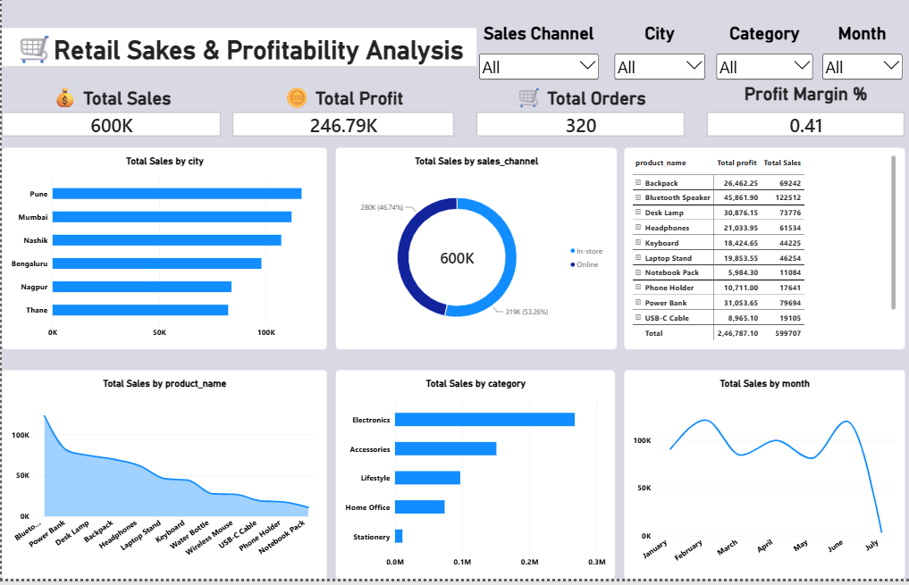

# Retail Store Sales & Profitability Analysis

**Project type:** Small end-to-end Data Analyst portfolio project  
**Tools:** Python (pandas), SQL, Excel, Power BI  
**Data:** Synthetic retail transactions created for realistic practice; not real company data.

## Business scenario
A small multi-city retail business wants to understand sales, profit, customer activity, and channel performance over six months. The manager needs a compact report to decide which categories and cities deserve attention and which products may have weak margins.

## Dataset
- 468 transaction-line rows
- 320 distinct orders
- 137 distinct customers
- 12 products across 5 categories
- Six cities; Online and In-store channels
- Jan–Jun 2026
- Columns include order/customer/product IDs, date, city, channel, payment method, quantity, prices, discount, cost, sales and profit fields.

## Folder structure
- `data/raw/retail_sales_raw.csv` — intentionally includes a few small quality issues.
- `data/cleaned/retail_sales_cleaned.csv` — cleaned data with sales/profit calculations.
- `python/analyze_sales.py` — repeatable cleaning and exploratory analysis.
- `sql/schema.sql` — table definition.
- `sql/analysis_queries.sql` — business questions as SQL queries.
- `excel/Retail_Sales_Analysis.xlsx` — raw, cleaned, KPI, category, city and monthly sheets.
- `power_bi/DAX_Measures.dax` — Power BI measures.
- `power_bi/Power_BI_Guide.md` — dashboard layout and import steps.

## How to run
1. Install Python 3.10+.
2. In a terminal from the project folder run: `pip install pandas`.
3. Run: `python python/analyze_sales.py`.
4. Use `sql/schema.sql` to create the table in your SQL tool and import the cleaned CSV.
5. Open the Excel workbook for prebuilt summaries and KPI overview.
6. In Power BI Desktop, import the cleaned CSV and follow the Power BI guide.

## Recommended dashboard
KPI cards: Total Sales, Total Profit, Total Orders, Profit Margin %.  
Charts: monthly sales/profit trend, sales by category, sales by city, top 5 products by units, channel mix.  
Slicers: date, city, category, channel, payment method.

## Resume-ready project entry
**Retail Store Sales & Profitability Analysis | Python, SQL, Excel, Power BI**
- Cleaned and analyzed 468 retail transaction lines using Python (pandas), handling missing discounts and inconsistent text values; calculated net sales, costs, profit and margin.
- Wrote SQL queries to evaluate monthly trends, category/city performance, top products and sales-channel mix; built an Excel KPI summary and a Power BI dashboard plan for business reporting.

- ## Power BI Dashboard

The interactive Power BI dashboard provides insights into retail sales performance and profitability.

### Dashboard Preview

### Project File

[Download the Power BI Dashboard (.pbix)](Retail_Sales_Profitability_Analysis.pbix)

**Note:** This is synthetic practice data. Only claim the Power BI dashboard as completed after you build and save it in Power BI Desktop. The provided guide and DAX measures are ready to use, but a `.pbix` file cannot be generated automatically here.
